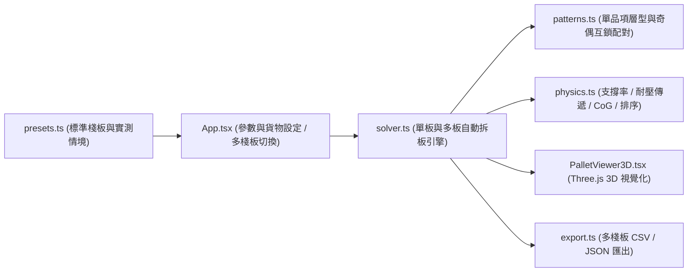

# 3D 棧板智慧裝箱系統（Pallet Packing 3D）

> 結合 **奇偶層互鎖（Odd/Even Interlocking）**、**物理穩定性驗證（重心 / 支撐率 / 單箱耐壓傳遞）**、**貨物公差空隙控制** 與 **多棧板自動拆板規劃** 的互動式 3D 裝箱系統。

- **線上瀏覽網址**：[https://linbenshow.github.io/pallet-packing-3d/](https://linbenshow.github.io/pallet-packing-3d/)
- **預設單位**：長度 `cm`（支援小數）、重量 `kg`（支援至 `0.001 kg`）
- **技術棧**：React 19 + TypeScript + Vite + Three.js + Vitest + GitHub Actions

---

## 目錄

1. [系統特色與核心能力](#1-系統特色與核心能力)
2. [使用說明（操作指南）](#2-使用說明操作指南)
3. [技術報告與演算法設計](#3-技術報告與演算法設計)
4. [內建實測資料與驗證結果](#4-內建實測資料與驗證結果)
5. [專案結構與本機開發](#5-專案結構與本機開發)

---

## 1. 系統特色與核心能力

- **雙模式智慧排法（同質最佳互鎖 + 異質混裝分層）**
  - **單一品項（同質貨物）**：自動探索並列（Block）、雙區交錯（Split-X / Split-Y）、風車互鎖（Pinwheel）、交錯列（Brick-Row）等工業標準板型，並透過奇偶層變換達成高互鎖率。
  - **多品項混裝（異質貨物）**：採分層建構（Layer-building），優先將重物與高耐壓貨物置於底層、同高度與同品項集中，並於偶數層翻轉填充方向以促進跨箱互鎖。
- **多棧板自動拆板規劃（Multi-Pallet Auto-Splitting）**
  - 面對數百至數千箱的交貨訂單，自動拆分為多塊棧板並歸納為「標準板型群組（Template Groups）」，方便倉儲現場或機械手臂重複作業。
- **嚴格物理約束檢查**
  - **僅允許水平旋轉 90°**：所有貨物維持正向朝上，不側躺、不倒放。
  - **零超邊界（Zero Overhang）**：嚴格限制在棧板長寬與最大允許堆高內。
  - **實際貨物公差空隙（`gapCm`）**：可選擇保留相鄰箱體微幅間隙（如 `0.5 cm`），貼近現場紙箱膨脹與作業公差。
  - **嚴格底面支撐率**：非底層貨物須達指定支撐面積比例（預設 ≥ 78%，可調）。
  - **獨立單箱耐壓上限（`maxLoad`）**：自上而下依接觸面積比例傳遞負重，避免下層紙箱壓潰。
  - **3D 重心控制（CoG）**：即時計算三維重心與水平偏移，於 3D 畫面與俯視雷達圖標示安全範圍。
- **堆疊容易度與作業整合**
  - 依「由下而上、由後往前、由左至右」產出無碰撞放置序列，兼顧人工搬運與機械手臂（Palletizer）作業路徑。
  - 支援 **逐箱堆疊動畫播放**、**逐層篩選**、**品項色 / 奇偶層色 / 承重熱力圖** 切換，以及 **整批多棧板 CSV / JSON 匯出**。

---

## 2. 使用說明（操作指南）

### 2.1 快速上手
1. 開啟線上網站：[https://linbenshow.github.io/pallet-packing-3d/](https://linbenshow.github.io/pallet-packing-3d/)
2. 點擊上方預設情境按鈕即可一鍵切換測試案例：
   - **實測組 1 (18品項混裝)**：18 筆異質尺寸與極端重量差（`0.005 kg` ~ `176 kg`）混裝範例。
   - **實測組 2 (交貨清單 1920箱)**：14 筆大量交貨訂單，自動執行多棧板拆板與板型分組。
   - **單品項奇偶層互鎖**、**多品項重輕混裝**、**歐規風車/交錯互鎖**、**單箱耐壓極限測試**。

### 2.2 左側面板：參數與貨物設定
- **棧板規格**：可選亞洲標準（120×100 cm）、歐規 EUR（120×80 cm）、日規（110×110 cm）、美規 GMA（121.9×101.6 cm），或自由輸入自訂長、寬、最大堆高與最大承重。
- **堆疊與穩定性參數**：
  - **啟用奇偶層互鎖**：開啟後可選擇「自動最佳化」、「旋轉 180°」、「X 軸鏡像」或「Y 軸鏡像」。
  - **考量貨物公差保留空隙**：勾選後可設定箱與箱之間的保留間隙（單位 `cm`，支援小數如 `0.3`、`0.5`、`1.0`）。
  - **最小底面支撐率 / 重心容許偏移上限**：拖曳滑桿即時重算。
  - **重物與高耐壓優先置底 / 同品項集中**：依實際倉儲需求開關。
- **貨物清單**：點擊「**新增品項**」可建立自訂貨物，輸入長、寬、高（`cm`）、重量（`kg`）、單箱耐壓上限（`kg`）、數量與顏色，系統會即時更新 3D 排法。

### 2.3 中央 3D 視窗：互動檢視與播放
- **視角操作**：滑鼠左鍵旋轉、右鍵平移、滾輪縮放；上方工具列可一鍵切換「等角 3D / 俯視圖 / 正視圖 / 側視圖」。
- **著色模式**：
  - **品項色**：依各 SKU 自訂顏色顯示。
  - **奇偶層色**：奇數層（藍色）與偶數層（橘黃色）高對比顯示，搭配「俯視圖」可清楚檢視跨箱互鎖效果。
  - **承重熱力**：以綠 → 黃 → 紅呈現每個箱體的頂部負重比例（`loadOnTop / maxLoad`）。
- **單箱檢視**：將滑鼠移至任一貨箱上，左下角會顯示該箱的放置順序、層數奇偶、精確座標 `(X, Y, Z)`、實放尺寸、頂部負重與底面支撐／互鎖狀態。
- **逐箱動畫與逐層篩選**：利用下方播放鍵與進度條預覽堆疊順序，或點擊 `L1 / L2 / ...` 標籤單獨聚焦檢視特定層。
- **多棧板切換列**（當總量超過 1 板時自動出現）：可透過左右箭頭或下拉選單切換任意棧板編號，或直接點擊右側「**拆板板型總覽**」跳至各標準板型。

### 2.4 右側面板與報表匯出
- 檢視裝載箱數、層間互鎖率、有效體積率、本板重量、物理安全檢查清單、**俯視重心雷達圖**與分層明細。
- 點擊右上角 **CSV 順序表**（含 UTF-8 BOM，Excel 開啟不亂碼）或 **JSON**，即可匯出包含棧板編號、放置順序、座標與負重資訊的完整作業清單。

---

## 3. 技術報告與演算法設計

### 3.1 系統模組架構



### 3.2 貨物公差空隙與零超邊模型
設棧板沿某軸長度為 $S$、貨物邊長為 $d$、箱間保留公差空隙為 $g \ge 0$。在嚴格零超邊條件下，該軸最多可排入的箱數為：

$$n = \left\lfloor \frac{S + g}{d + g} \right\rfloor$$

相鄰兩箱 $A, B$ 在同一高度層必須滿足分離條件：

$$(x_A + dx_A + g \le x_B) \lor (x_B + dx_B + g \le x_A) \lor (y_A + dy_A + g \le y_B) \lor (y_B + dy_B + g \le y_A)$$

且每層完成後會對齊棧板中心偏移 $\Delta x = (L - \text{span}_X)/2$、$\Delta y = (W - \text{span}_Y)/2$，使奇偶層在鏡像或 180° 旋轉後輪廓對稱重疊，同時壓低水平重心偏移。

### 3.3 奇偶層互鎖演算法（Odd / Even Layer Interlocking）
- **單品項層型生成（`patterns.ts`）**：自動窮舉 `Block-0`、`Block-90`、`Split-X`、`Split-Y`、`Pinwheel`（四象限風車）、`Brick-Row`（交錯列）等候選板型。
- **雙向互鎖配對評估**：將候選奇數層 $P_{\text{odd}}$ 與其變換（`rotate-180`、`mirror-x`、`mirror-y`）或另一高密度板型 $P_{\text{even}}$ 配對，同時驗證 $P_{\text{odd}} \to P_{\text{even}}$ 與 $P_{\text{even}} \to P_{\text{odd}}$ 兩個方向的最低底面支撐率皆 $\ge \text{minSupportRatio}$。
- **有效互鎖定義**：上層箱體底面若同時與 $\ge 2$ 個下層箱體重疊，且每個支撐箱各自貢獻至少 $5\%$ 的底面接觸面積（排除微弱擦邊），即判定為有效跨接互鎖（Cross-tie）。
- **混裝層互鎖**：異質混裝於偶數層會自動翻轉候選極值點（Extreme Points）的掃描方向並優先嘗試 90° 旋轉方向，在評分函數中給予跨接互鎖額外權重。

### 3.4 嚴格物理引擎（`physics.ts`）
1. **精確底面支撐率**：計算候選箱體底面矩形與所有頂面高度落於 $[z - 0.15, z + 0.15]\text{ cm}$ 之已放置箱體的 2D 交集面積總和，須滿足 $\text{supportRatio} \ge \text{minSupportRatio}$。
2. **自上而下耐壓負重傳遞（Top-Down Load Propagation）**：
   將所有已放置箱體依高度 $z$ 由高至低拓撲排序。對每個箱體 $i$，其向下傳遞之總負重為 $F_i = w_i + L_{\text{top}, i}$，並依與各下層支撐箱 $j$ 的接觸面積比例 $A_{ij} / \sum_k A_{ik}$ 分攤累加至下層箱體的 $L_{\text{top}, j}$。任何候選放置若會導致任一下層箱體 $L_{\text{top}, j} > \text{maxLoad}_j$ 即予以拒絕。
3. **3D 重心計算（CoG）**：
   $$(X_{\text{cog}}, Y_{\text{cog}}, Z_{\text{cog}}) = \frac{1}{\sum w_i} \sum_i w_i \left(x_i + \frac{dx_i}{2},\; y_i + \frac{dy_i}{2},\; z_i + \frac{dz_i}{2}\right)$$
4. **無碰撞放置順序與堆疊容易度評分（0–100 分）**：
   - 依 `layerIndex` 遞增、同層依「由後往前（$y$ 遞增）、由左至右（$x$ 遞增）」編號，避免產生四周封閉的深洞。
   - 容易度綜合評分由三項構成：**層內高度平整度（35 分）** + **同品項連續集中度（30 分）** + **板型規則性與平均支撐度（35 分）**。

### 3.5 多棧板自動拆板與同型快複製（`solveMultiPalletPacking`）
針對大量交貨訂單（如 1,920 箱），演算法採迭代拆板搭配 **同型板快複製（Fast-Cloning）**：
1. 每次針對剩餘庫存求解一塊最佳棧板，統計各 SKU 在該板消耗數量 $u_k$。
2. 計算目前剩餘庫存可立即複製出的相同滿載板數：
   $$R = \min_{k:\, u_k > 0} \left\lfloor \frac{\text{rem}_k}{u_k} \right\rfloor$$
3. 直接將該板型複製 $R$ 板並扣除 $u_k \cdot R$，省去數十次重複的 3D 幾何搜尋。
4. 最後依各板的 SKU 組成與分層排法產生簽章（Signature），自動彙整為 **拆板板型總覽（`PalletTemplateGroup`）**。

### 3.6 利用率門檻與不裝貨決策（Minimum Utilization Gate）
實務倉儲出貨時，若最後一塊尾板（或小量訂單）裝載率過低，強行派板會造成運費與棧板浪費。系統提供「**未達利用率門檻則不裝貨**」開關，以 **綜合利用率** 作為派板門檻：

$$U_{\text{eff}} = \max\!\left(\frac{\sum V_{\text{box}}}{L \cdot W \cdot H_{\max}},\; \frac{\sum w_{\text{box}}}{W_{\max}}\right)$$

- 同時兼顧「拋貨（體積先滿）」與「重貨（重量先滿）」情境：只要體積率或承重率任一項達標即正常派板。
- 當 $U_{\text{eff}} < \text{minUtilizationRatio}$ 時，系統自動選擇**不裝貨／不派板**，並將剩餘品項列於「保留未裝貨清單」與顯示預估利用率明細。

### 3.7 模組化分區裝板（1/1 · 1/2 · 1/4）與填充率權衡
為解決異質高度貨物在純 1/1 整層模式下容易浪費空間的問題，系統引入倉儲標準的 **1/1 整層 / 1/2 半層雙區 / 1/2 + 雙 1/4 混合區 / 4×1/4 四分區** 模組化空間切分（`src/core/zones.ts`）：

- **獨立區內堆高與多高度支撐面**：每個分區各自維護獨立的可用高度層清單（`zLevels`）與奇偶層狀態，區域間嚴格保留 `gapCm` 公差空隙；較矮箱體可持續利用同區底面與已放箱體頂面往上堆疊，不再被單一超高貨件鎖死整板高度。
- **填充率 vs 互鎖策略硬性底線**：提供「填充率優先（0% 箱數折讓）」、「均衡（預設，互鎖最多折讓 5% 箱數）」、「互鎖穩定優先（最高 15%）」三種模式，避免為了互鎖而過度犧牲裝箱數量。
- **動態擇優（`zoneMode = 'auto'`）**：大宗單品項優先採用 1/1 整層奇偶互鎖；異質混裝與尾板則自動比較 `1/1`、`1/2`、`1/2+雙1/4` 與 `4×1/4`，挑選綜合利用率與穩定性最佳的方案，並於 3D 棧板底面繪製分區輔助框線。

---

## 4. 內建實測資料與驗證結果

本專案透過 `Vitest` 建立完整自動化測試（`src/core/solver.test.ts`），驗證 8 項核心情境：

| 測試項目 | 驗證重點 | 狀態 |
| --- | --- | --- |
| 單品項奇偶層互鎖（含 0.5 cm 公差） | 互鎖率 > 50%、零超邊、相鄰間距嚴格 ≥ 0.5 cm、重心平衡 | 通過 |
| 關閉互鎖對照組 | 柱狀堆疊互鎖率為 0%、零超邊 | 通過 |
| 多品項重輕混裝 | 重型高耐壓箱平均高度低於輕量易碎箱、耐壓與支撐安全 | 通過 |
| 單箱耐壓極限保護（35 kg 上限） | 所有箱體 `loadOnTop ≤ maxLoad`，自動停止過度疊加 | 通過 |
| 無碰撞堆疊順序 | 序列編號嚴格 `1..N` 且層數單調遞增 | 通過 |
| 實測組 1（18 品項混裝） | 支援 `0.005 kg` ~ `176 kg` 極端重量差與多組小數尺寸 | 通過 |
| 實測組 2（單板壓力測試） | 1,920 箱訂單快速求解不卡頓 | 通過 |
| 實測組 2（多棧板自動拆板） | 1,920 / 1,920 箱 100% 裝載、0 遺漏、全數通過安全檢查 | 通過 |

### 4.2 3D-BPP 文獻大訂單基準測試（10 組 12,301 箱，全數 ≥ 95.8%）
依據 3D 裝箱與棧板堆疊經典文獻建立 10 組可重現之大型多棧板基準測試集（`src/core/benchmarks.ts` / `src/core/benchmarks.test.ts`），涵蓋四大類別：
- **Zero-Waste Ground-Truth（精確已知最佳解 $P^*$）**：由 1/1、1/2、1/4 模組化標準棧板反推切分生成，具嚴格已知最佳板數。
- **Bischoff & Ratcliff (1995) / Davies & Bischoff (1999)**：OR-Library `BR1–BR15` 弱／中／強異質（5 ~ 25 品項）大訂單分佈。
- **Martello, Pisinger & Vigo (2000)**：Operations Research `MPV` Class II / III 尺寸比例分佈。
- **Gzara, Elhedhli & Yildiz (2020)**：零售業 Mixed-Case Palletization（`MCP`）大訂單。

參考答案 $P_{\text{ref}}$ 定義為已知精確最佳解（GT 類）或嚴格離散單品項容量下界 $\max(P_{\text{LB}}, \lceil \sum_i q_i / C_i \rceil)$（BR / MPV / MCP 類），達成率為 $\min(100\%,\; P_{\text{ref}} / P_{\text{solver}} \times 100\%)$：

| 測資編號 | 文獻依據 / 類型 | 總箱數 | 參考答案 ($P_{\text{ref}}$) | 實測板數 ($P_{\text{sol}}$) | 達成率 | 平均總體積率 | 物理安全 |
| --- | --- | :---: | :---: | :---: | :---: | :---: | :---: |
| `gt-1-full-layer` | Ground-Truth 1/1 整層 | 663 | 10 | **10** | **100.0%** | 97.6% | 通過 |
| `gt-2-half-zone` | Ground-Truth 1/2 半層 | 724 | 12 | **12** | **100.0%** | 97.5% | 通過 |
| `gt-3-quarter-zone` | Ground-Truth 1/4 四分區 | 1,125 | 15 | **15** | **100.0%** | 97.3% | 通過 |
| `gt-4-euro-large` | Ground-Truth 歐規 120×80 | 1,089 | 20 | **20** | **100.0%** | 97.5% | 通過 |
| `br-low-hetero` | Bischoff & Ratcliff (5品項) | 1,200 | 29 | **29** | **100.0%** | 91.1% | 通過 |
| `br-mid-hetero` | Bischoff & Ratcliff (12品項) | 1,500 | 33 | **33** | **100.0%** | 91.6% | 通過 |
| `br-high-hetero` | Davies & Bischoff (25品項) | 1,000 | 23 | **24** | **95.8%** | 85.4% | 通過 |
| `mpv-class2` | Martello-Pisinger-Vigo C2 | 1,400 | 31 | **32** | **96.9%** | 73.5% | 通過 |
| `mpv-class3` | Martello-Pisinger-Vigo C3 | 2,000 | 23 | **23** | **100.0%** | 73.7% | 通過 |
| `mcp-retail-large` | Gzara & Elhedhli MCP | 1,600 | 31 | **32** | **96.9%** | 90.3% | 通過 |
| **總計 / 平均** | **10 組大訂單（12,301 箱）** | **12,301** | — | — | **98.96%（最低 95.83%）** | — | **100% 通過** |

---

## 5. 專案結構與本機開發

### 目錄結構
```text
pallet-packing-3d/
├── .github/workflows/deploy.yml   # GitHub Pages 自動測試、建置與部署流程
├── src/
│   ├── core/
│   │   ├── types.ts               # 核心資料型別（單板 / 多板 / 物理指標）
│   │   ├── physics.ts             # 支撐率、耐壓傳遞、3D 重心與容易度評分
│   │   ├── patterns.ts            # 單品項經典層型與奇偶層互鎖配對
│   │   ├── solver.ts              # 單板與多棧板自動拆板演算法
│   │   ├── presets.ts             # 標準棧板規格與 6 組內建/實測情境
│   │   └── solver.test.ts         # Vitest 單元測試套件
│   ├── components/
│   │   └── PalletViewer3D.tsx     # Three.js 互動式 3D 渲染與懸停檢視
│   ├── utils/
│   │   └── export.ts              # 多棧板 CSV / JSON 匯出工具
│   ├── App.tsx                    # 主介面與狀態控制
│   └── index.css                  # 深色工程儀表板樣式
├── vite.config.ts
└── package.json
```

### 本機指令
```bash
# 安裝依賴
npm install

# 啟動本機開發伺服器 (http://localhost:5173)
npm run dev

# 執行單元測試
npx vitest run

# 型別檢查與正式環境建置
npm run build
```

### 自動部署說明
本專案已配置 `.github/workflows/deploy.yml`：每當程式碼推送至 `main` 分支，GitHub Actions 會自動執行 `npm ci` → `npx vitest run` → `npm run build`，並將 `dist/` 部署至 GitHub Pages。
